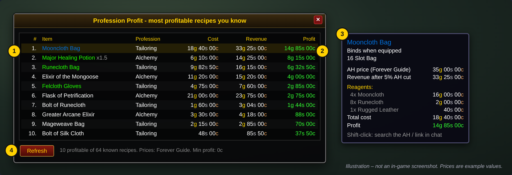
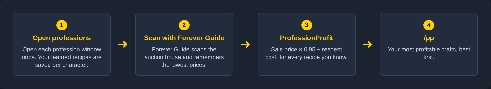
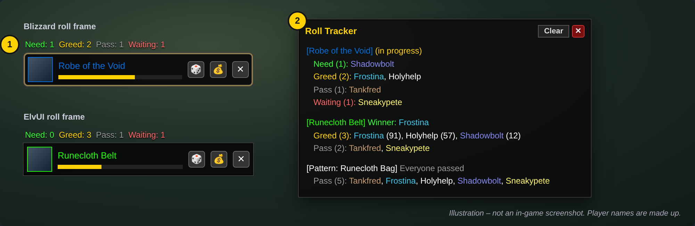

# WoW Forever Addons

Two small, lightweight addons for **WoW Forever**:

| Addon | What it does | Command |
|---|---|---|
| [**ProfessionProfit**](#-professionprofit) | Ranks the recipes **you know** by how much gold they make, using **Forever Guide**'s auction house scan | `/pp` |
| [**RollTracker**](#-rolltracker) | Shows what everyone picked – **Need, Greed or Pass** – on every drop. Works **with or without ElvUI** | `/rt` |

> [!NOTE]
> The pictures in this README are **illustrations** of the addon windows, not in-game screenshots.
> Prices and player names in them are example values.

---

## Contents

- [Installation](#installation)
- [💰 ProfessionProfit](#-professionprofit)
- [🎲 RollTracker](#-rolltracker)
- [Troubleshooting](#troubleshooting)
- [Project layout](#project-layout)

---

## Installation

1. Download this repository (**Code → Download ZIP**) and unzip it.
2. Copy the addon folders you want into your AddOns folder:

   ```
   World of Warcraft/<client>/Interface/AddOns/
   ├── ProfessionProfit/
   └── RollTracker/
   ```

   Copy the folders themselves, not the files inside them.

3. Start the game (or `/reload`). On the character screen, open **AddOns** and make sure both are ticked.
   If they show as *out of date*, tick **Load out of date AddOns**.

**ProfessionProfit** requires the [Forever Guide](https://www.curseforge.com/wow/addons/forever-guide) addon.
**RollTracker** has no requirements. ElvUI is optional.

---

## 💰 ProfessionProfit

> *"What should I craft right now to make the most gold?"*

ProfessionProfit takes every recipe your character **has actually learned** and works out its profit
from **Forever Guide**'s auction house prices. You get one list with the best crafts at the top.



1. **Your recipes, ranked**: only recipes this character knows, best profit first. Item names use quality colors, and `x1.5` means the recipe makes several items on average.
2. **Profit after the AH cut**: the 5 % auction house cut is already subtracted.
3. **Hover for details**: hover a row to see the Forever Guide price, each reagent's cost and the total.
4. **Refresh** after a new Forever Guide scan. The status line shows how many of your recipes are profitable.

### How it works



```
profit = AH price × amount made × 0.95  −  reagent cost
```

- **AH prices come only from Forever Guide.** No other AH addon is used.
- **Reagents** are costed at the cheaper of the Forever Guide price and the **vendor price**. Vendor prices are learned automatically when you open a vendor, so thread, vials, flux and similar reagents get their real cost.
- Recipes whose result **can't be sold on the AH** (soulbound, no listings) are hidden. So are recipes where a reagent has no price.

### Getting started

1. **Open each profession window once** (Tailoring, Alchemy, Enchanting, …). Your recipes are saved per character. Do it again after you learn new recipes.
2. **Scan the auction house with Forever Guide.**
3. Type **`/pp`**.

### Commands

| Command | Description |
|---|---|
| `/pp` | Show / hide the list |
| `/pp min 1g50s` | Only show recipes with at least this much profit (`5g`, `75s`, `1g50s`, …) |
| `/pp status` | Show whether Forever Guide's prices were found, and which recipes are saved |
| `/pp fgdump` | Troubleshooting: print what Forever Guide's saved data looks like |
| `/pp reset` | Forget this character's saved recipes |
| `/pp help` | List all commands |

**Tips**
- **Shift-click** a row to search for the item on the AH (or link it in chat when the AH is closed).
- Use `/pp min 1g` to hide crafts that are barely worth the effort.

---

## 🎲 RollTracker

> *"Who needed on that? Is anyone still choosing?"*

RollTracker shows **what everyone in your group picked** on each drop, while the roll is still going.



1. **Counts on the roll frame itself**: `Need · Greed · Pass · Waiting` above every roll frame. It works on **Blizzard's** roll frames and on **ElvUI's**. Hover the counts to see the names.
2. **The Roll Tracker window** opens automatically when something drops. It shows for each item:
   - who picked **Need / Greed / Pass** (and Disenchant / Transmog if the game has them),
   - who is **still waiting** to choose,
   - the **roll numbers**, highest first,
   - the **winner**, or *Everyone passed*.

   Names are shown in class colors. The window can be moved, resized (drag the bottom-right corner) and closed with ✕.

### With or without ElvUI

| | Without ElvUI | With ElvUI |
|---|---|---|
| Choice tracking | ✅ | ✅ |
| Counts on roll frames | ✅ Blizzard frames | ✅ ElvUI frames |
| Window style | Blizzard tooltip style | ElvUI style (frame, font, buttons) |

RollTracker reads the loot messages the game already prints in chat, like *"Frostina has selected Greed for: [Runecloth Belt]"*.
It uses the game's own translated texts, so it works in **any client language** and with **any UI** that shows the roll frames.

### Commands

| Command | Description |
|---|---|
| `/rt` | Show / hide the window |
| `/rt auto` | Toggle opening the window automatically when a roll starts |
| `/rt clear` | Clear the roll history (the window's **Clear** button does the same) |

The last 15 drops are kept.

---

## Troubleshooting

<details>
<summary><b>ProfessionProfit says "No prices found from Forever Guide"</b></summary>

1. Make sure Forever Guide is enabled, then do a full auction house scan with it.
2. Press **Refresh** in the ProfessionProfit window, or type `/pp status`.
3. If it still can't find the prices: Forever Guide has no public API for other addons, so ProfessionProfit
   looks for its saved price data by itself, and Forever Guide may store it in a way it doesn't recognise yet.
   Run `/pp fgdump`, then `/reload`, and open an issue with the `fgdump` section from:

   ```
   WTF/Account/<account>/SavedVariables/ProfessionProfit.lua
   ```

   The connection can then be adapted exactly to Forever Guide.
</details>

<details>
<summary><b>ProfessionProfit says "No recipes saved"</b></summary>

Open each profession window once. The game only provides the recipe list while that window is open.
</details>

<details>
<summary><b>A recipe I know is missing from the list</b></summary>

It is hidden when the crafted item has no Forever Guide price (not listed on the AH, or soulbound),
when a reagent has no price, or when its profit is below your `/pp min` value.
Hover rows and check `/pp status` to see what is known.
</details>

<details>
<summary><b>RollTracker only shows the winner, or nothing</b></summary>

RollTracker relies on the loot messages in chat. Make sure loot messages are enabled in the chat tab:
right-click the tab → **Settings** → tick **Loot**.
If it still doesn't work, please open an issue and paste a few loot lines from chat.
</details>

---

## Project layout

```
ProfessionProfit/
├── ProfessionProfit.toc
├── Core.lua       saved data, events, slash commands
├── Recipes.lua    reads learned recipes from the profession windows
├── Prices.lua     Forever Guide prices + profit calculation
├── Vendor.lua     learns vendor prices for reagents
└── UI.lua         the profit list window
RollTracker/
├── RollTracker.toc
├── Core.lua       parses loot chat, tracks choices per drop
└── UI.lua         window, roll frame counts, ElvUI styling
docs/
├── images/        pictures used in this README
└── mockups/       HTML sources for the pictures (node shot.js <out-dir>)
```
